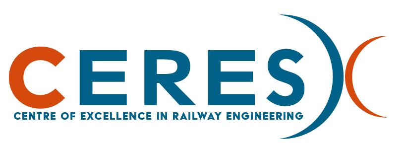



_©CERES_

## Project description

The project aims to establish the Centre of Excellence in Railway Engineering (CERES) at Poznan University of Technology to transform railway research and innovation capacity in Poland and wider in the Central and Eastern European (CEE) region. While rail transport plays a vital role as Europe’s circulatory system for safe, sustainable, and efficient mobility, CEE countries remain significantly underrepresented in international railway R&I efforts. CERES addresses this gap by creating a world-class, autonomous and sustainable research centre focused on four strategic pillars: System Optimisation, Multimodality, Sustainability, and Inclusive and Personalised Service.
CERES will be formed through a strategic alliance with three leading European research institutions: Technical University of Berlin, University of Huddersfield, and Université Polytechnique Hauts-de-France. The Centre will form a multidisciplinary team comprising internationally recognized scientists, conduct international cutting-edge research, train new generations of railway researchers and engineers, and foster strong industry-academia collaboration. The project includes a demonstative research initiative focused on creating Digital Twin models for predictive maintenance of urban transport system, using real-world data from Poland and Germany. Other key initiatives include the creation of a Railway Excellence Alliance, the launch of Open Science Railway Portal, and proactive contributions to EU priorities such as TEN-T, Rail Baltica, and the European Green Deal as well as national ones. The project includes comprehensive communication and dissemination activities to promote results and engage key stakeholders at national and international levels. The Centre will be empowered by organizational autonomy, robust governance, and complementary funding from national and European sources. Ultimately, the Centre will be resourced in long-term through industrial commissions and research grants.

<ca. 1 paragraph on VSP WP>
  

## Funding agency

[European Research Executive Agency (REA), under the powers delegated by the European Commission](https://rea.ec.europa.eu)

Grant agreement ID: 101250551 

_©European Union_

## Contact

[Prof. Dr. Kai Nagel](https://www.tu.berlin/vsp/ueber-uns/fachgebietsleitung), TU Berlin

[M.Sc. Gregor Leich](https://www.tu.berlin/vsp/team), research assistant

## Project partners

-   Politechnika Poznańska (project head)
-   Université Polytechnique Hauts-de-France
-   University of Huddersfield
-   Technische Universität Berlin: Department of Rail Vehicles / Schienenfahrzeuge

## Projektseite

[project website at funding agency](https://cordis.europa.eu/project/id/101250551/de)

<Verweis auf Webseite bei Projektleitung, falls es eine gibt>
